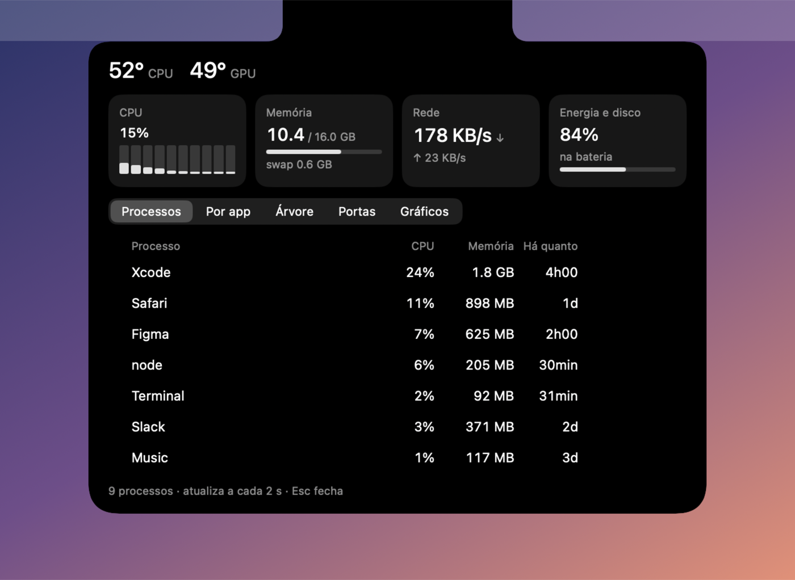
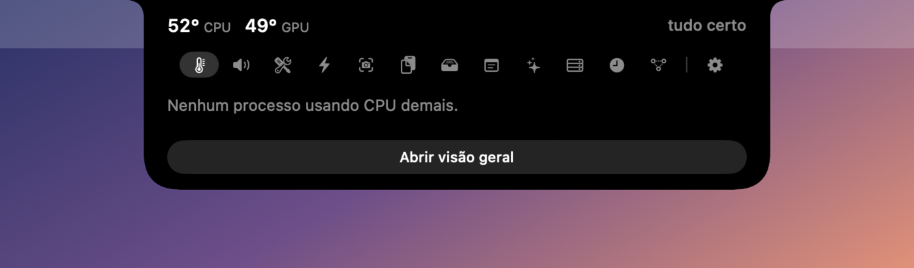
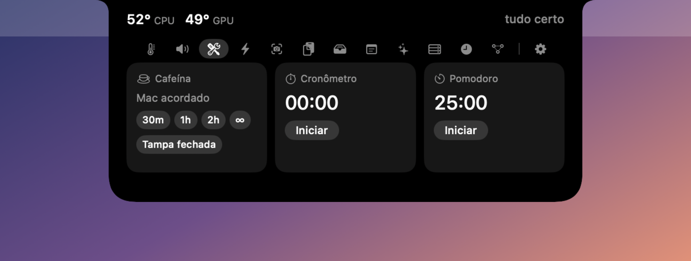
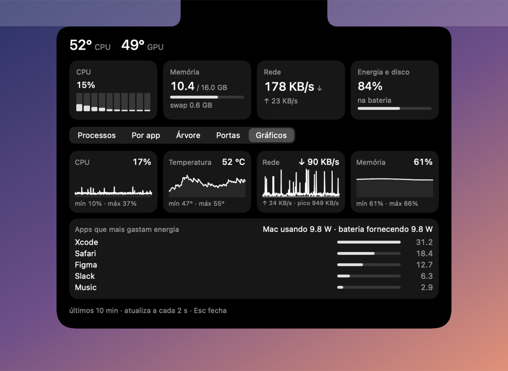
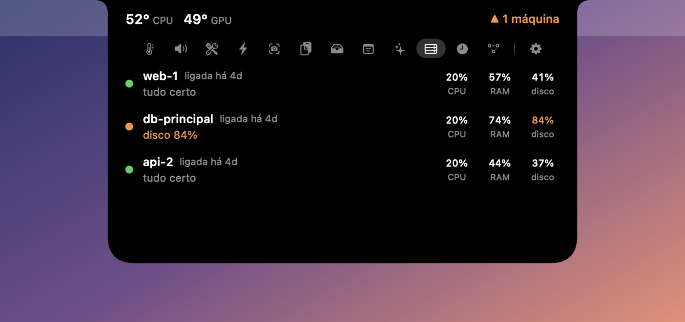
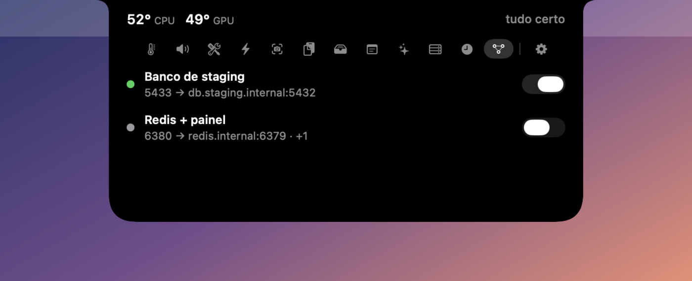

<div align="center">

<h1>iLand</h1>


**Foco, sistema e ferramentas do dia a dia. Sempre por perto.**

[Ver versões](https://github.com/FilhooDeAnder/iLand/releases) · [Conhecer os recursos](#um-espaço-pequeno-para-muita-coisa) · [Compilar](#para-quem-desenvolve) · [MIT](LICENSE)

**macOS 13+ · Apple Silicon · Swift + SwiftUI · Open source**

</div>

---

O **iLand** transforma o notch do Mac em um lugar para acompanhar o sistema, manter o foco e acessar
ferramentas sem sair do que você está fazendo. Passe o mouse para abrir a vista rápida; use a janela
principal quando precisar de mais espaço.

<div align="center">
  
</div>

> Todos os prints usam dados fictícios, gerados por `scripts/readme_shots.sh`.

## Um espaço pequeno para muita coisa

| | O que fica por perto |
|---|---|
| **Sistema** | Temperatura, CPU, memória, bateria, processos, energia e portas de rede. |
| **Foco** | Pomodoro, cronômetro e cafeína para manter o Mac acordado. |
| **Capturas** | Captura de tela, edição, anotações, histórico e compartilhamento configurável por S3. |
| **Seu dia** | Tempo por aplicativo e projeto, contexto para retomar o trabalho e resumo do dia. |
| **Ferramentas** | Som, atalhos, notas, área de transferência e prateleira de arquivos. |
| **Assistente** | Claude Code, Codex ou Ollama, com ferramentas para consultar o contexto e propor ações. |
| **Integrações opcionais** | Timer e tasks do ClickUp; acompanhamento de máquinas Linux por SSH; túneis SSH com liga/desliga. |

### Passe o mouse, clique, arraste

<p align="center">
  
</p>

Com o mouse sobre o notch, as **orelhas** mostram o uso do Claude nas janelas de 5 horas e de 7 dias.
Um clique abre a **vista rápida**; arrastar com dois dedos troca de página, e para baixo abre a visão geral.
A engrenagem no fim da barra de ícones abre os Ajustes da página em que você está.

<p align="center">
  
</p>

### Uma coisa por vez

<p align="center">
  
</p>

Os timers ficam acessíveis no notch. Quando o painel está fechado, as orelhas mostram informações
compactas; a vista rápida reúne os controles.

### Seu Mac, num olhar

<p align="center">
  
</p>

A visão geral ajuda a entender o consumo de recursos e os processos em execução. Encerrar um processo
sempre pede confirmação. As abas mostram os processos por app, em árvore, as portas abertas e os gráficos
dos últimos 10 minutos, com os apps que mais gastam energia.

### Servidores e túneis

<p align="center">
  
</p>

**Máquinas** acompanha servidores Linux por SSH: CPU, memória e disco a cada 5 minutos, sem instalar nada
neles. Amarelo avisa nas orelhas; vermelho abre a página sozinho, com **Explicar** e **Abrir SSH**.

<p align="center">
  
</p>

**Serviços** liga e desliga, num clique, o que precisa ficar rodando: comandos locais (um servidor de
desenvolvimento, por exemplo) e túneis SSH (`ssh -L`). Em **Ajustes › Serviços**, cadastre o comando com a pasta e
um link opcional (o botão **Testar** roda o comando por alguns segundos antes de salvar), ou cole o comando ssh que
você já usa. Se o túnel cair, o iLand liga de novo sozinho.

## Instalar

**Requisitos:** Mac com chip Apple (M1 ou mais novo), macOS 13 ou superior.

1. Abra [Releases](https://github.com/FilhooDeAnder/iLand/releases). Se houver uma versão publicada, baixe o `iLand.dmg`.
2. Abra o `.dmg` e arraste o iLand para **Aplicativos**.
3. Abra o aplicativo e siga a configuração inicial. As integrações são opcionais.
4. Se o macOS bloquear a abertura, consulte o aviso em **Ajustes do Sistema › Privacidade e Segurança**.

A publicação pelo GitHub Actions depende da configuração do certificado de assinatura pelo mantenedor.
Se ainda não houver um `.dmg`, você pode [compilar pelo código](#para-quem-desenvolve).

## Assistente com o modelo que você escolher

Em **Ajustes › Modelos**, conecte as ferramentas que já usa:

- **Claude Code:** CLI `claude` instalada e autenticada.
- **Codex:** CLI `codex` instalada e autenticada.
- **Ollama:** serviço em execução; modelos cloud exigem a autenticação do fornecedor.

O atalho **⌃⌥⌘Espaço** abre o assistente. Ele pode consultar projetos, contexto do dia e tasks.
Ações como parar um timer ou guardar uma memória aparecem para **Aprovar** ou **Recusar**.
Cada integração continua sujeita aos termos do respectivo fornecedor.

## Privacidade sem letras miúdas

O registro de atividade e as configurações ficam no Mac. **Usar um modelo remoto pode enviar contexto para
esse fornecedor.** Capturas só são enviadas ao armazenamento S3 quando você configura e usa o upload.

<details>
<summary><strong>O que o app lê e o que pode sair do Mac</strong></summary>

### Dados locais

- Aplicativo em uso, título da janela e projeto, mediante Acessibilidade. Campos de senha, janelas anônimas
  reconhecidas e tela bloqueada têm proteções específicas. O botão **Pausar** interrompe o registro.
- Sessões locais do Claude Code e Codex, pastas de projetos e metadados do Git. A leitura de sessões pode ser
  desligada em **Ajustes › Privacidade**.
- Histórico da área de transferência, notas, capturas e métricas do sistema.
- Credenciais das integrações que utilizam o Keychain do macOS.

### Conexões externas

| Destino | Quando e para quê |
|---|---|
| Provedor do modelo | Ao usar o assistente: pergunta, contexto e resultados das ferramentas consultadas. |
| Ollama local | Inferência local; escolher um modelo cloud muda o destino da inferência. |
| ClickUp | Quando conectado: consulta de tasks/timer e ações aprovadas. |
| Máquinas por SSH | Quando configuradas: consultas de métricas. |
| Serviços | Quando ligados: o comando cadastrado, rodando como você, e a conexão `ssh -L` dos túneis, rodando com sudo. Se o ssh der timeout, consulta o seu IP público em checkip.amazonaws.com para dizer qual IP liberar no servidor. |
| GitHub | Verificação de atualizações. |
| Armazenamento S3 | Upload de capturas, quando configurado e acionado. |

### Permissões

**Acessibilidade** permite identificar apps e projetos. **Automação**, solicitada quando necessária, permite
interações como abrir a aba certa do Terminal e identificar o modo anônimo em navegadores compatíveis.
Sem essas permissões, os recursos relacionados ficam limitados.

</details>

## Para quem desenvolve

Use um ambiente macOS com Command Line Tools/Xcode e SDK que inclua as APIs do macOS 26 utilizadas pelo
projeto. O aplicativo mantém o deployment target em macOS 13.

```bash
git clone git@github.com:FilhooDeAnder/iLand.git
cd iLand

./scripts/build.sh          # gera iLand.app na raiz
./scripts/build.sh --dmg    # gera também dist/iLand.dmg
./scripts/test.sh           # testes unitários e de captura
./scripts/readme_shots.sh   # refaz os prints do README com dados fictícios (Mac com notch)
```

Os scripts encontram a raiz pelo próprio caminho e podem ser chamados de outro diretório.
Para compilar e instalar em `/Applications`, use `./scripts/install.sh` — ele substitui a instalação existente.
Sem o certificado de release, o build usa assinatura ad-hoc; as permissões do macOS podem precisar ser concedidas novamente.

### Como o repositório está organizado

```text
iLand/
├── Sources/iLand/        # aplicativo Swift + SwiftUI
├── Resources/           # Info.plist e executável sensors
├── Tests/
│   ├── Unit/            # regras, parsers, composição e edição
│   ├── Fixtures/        # somente dados sintéticos
│   ├── Diagnostics/     # diagnósticos manuais de tela/notch
│   └── Manual/          # scripts que abrem o app
├── scripts/             # build, testes, instalação e desinstalação
├── legacy/              # protótipo Python, fora do build atual
└── .github/workflows/   # publicação de releases
```

Veja [Tests/README.md](Tests/README.md) para executar suítes isoladas.
O binário `Resources/sensors` é próprio do projeto; seu código-fonte ainda não está disponível neste repositório.

<details>
<summary><strong>Publicar uma versão</strong></summary>

Configure os secrets `ILAND_SIGNING_P12` e `ILAND_SIGNING_PASSWORD` no GitHub Actions.
Todas as versões devem usar o mesmo certificado para manter a identidade da assinatura.

Depois de revisar e integrar as alterações:

```bash
git tag v1.2.0
git push origin v1.2.0
```

A tag `v*` aciona o workflow que executa `scripts/build.sh --dmg` e publica o artefato no GitHub Releases.

</details>

## Contribuir

Encontrou um problema ou tem uma ideia? [Abra uma issue](https://github.com/FilhooDeAnder/iLand/issues)
com o cenário, o comportamento esperado e a versão do macOS. Remova dados pessoais de logs e capturas.
Para mudanças de código, abra um pull request e execute os testes relacionados.

## Licença

[MIT](LICENSE) · Copyright © 2025–2026 Anderson Carvalho.

Você pode usar, modificar, distribuir e vender cópias, inclusive em produtos fechados, preservando o aviso
de copyright e a licença. O software é fornecido sem garantia. Componentes e serviços externos mantêm suas
próprias condições; consulte [THIRD_PARTY_NOTICES.md](THIRD_PARTY_NOTICES.md).
